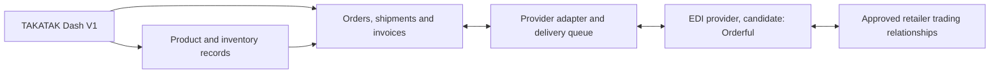

# Retail EDI for TAKATAK Inventory — Orderful assessment

Reviewed 2026-10-20 from the Orderful link supplied by the owner. This document records research and proposed product work. It does not implement EDI transport, establish a supplier relationship, certify retailer compliance or select a paid provider.

## Fit with the honey business

The inventory module in PR #218 supplies product records, consumer barcode labels, packaged-unit quantities and an adjustment ledger. Selling through a major retailer also involves supplier onboarding, product setup and potentially electronic business-document exchange. EDI is that document-exchange layer; it does not make an unregistered product automatically recognizable at a checkout.

The intended arrangement is:

TAKATAK remains the system of record for products, quantities, order approval and fulfillment. An EDI provider translates and delivers partner-specific documents and returns validation/delivery outcomes. The dashboard displays business progress and unresolved errors.

## What the source supports

Orderful's [SaaS platform page](https://www.orderful.com/solutions/saas-platforms) advertises a canonical JSON API and embedded EDI for software platforms. Its [food and beverage page](https://www.orderful.com/solutions/food-and-beverage) describes trading-partner connectivity and validation of shipment fields such as lot, expiry and pack size. These are vendor claims, not a completed TAKATAK integration test.

The platform page lists Walmart in its retailer network. This does not establish support for the honey supplier's specific Walmart Canada program, or for Super C or Maxi. Confirm each legal buyer, banner, distribution program, document set and connection with the retailer and proposed provider. The grocery blog discusses US retailers; it is not a Canadian retailer implementation guide.

[Published pricing](https://www.orderful.com/pricing), as displayed on the review date:

| Offering | Displayed starting price | Relevance |
| --- | --- | --- |
| Labels | $99/month | Logistics-label API, separate from consumer UPC/EAN labels |
| Web EDI Fulfillment | $189/month per trading partner | Manual web-based EDI operation |
| Integrated | $399/month | API integration candidate |
| Enterprise | Custom | The comparison table places multiple Orderful organizations here |

The page does not clearly identify currency in the reviewed text. Confirm currency, partner fees, onboarding, volume limits, contract terms and multi-customer SaaS rights directly. No account, subscription, purchase or vendor contact was initiated.

The linked developer documentation at `https://docs.orderful.com/` returned HTTP 403 from this environment. Exact authentication, endpoint versions, webhook verification, payload schemas, pagination, retry semantics and sandbox access are therefore unverified. Do not invent those details or use marketing examples as an API contract.

## Document flows to support

These are candidate flows, not a universal retailer checklist. Implement only the documents required by the actual trading-partner guide.

| Business event | Common X12 document | Required TAKATAK behavior |
| --- | --- | --- |
| Retailer orders stock | 850 purchase order; some grocery programs use 875 | Import once into the correct workspace and retailer account; match buyer item IDs to products and packaging |
| Supplier accepts or rejects an order | 855 purchase order acknowledgment | Require an order decision, check available quantities and reserve units when accepted |
| Goods ship | 856 advance ship notice (ASN) | Send actual shipped items, quantities, cartons/pallets and required lot/date details |
| Supplier invoices | 810 invoice; some grocery programs use 880 | Reference the order and shipment, use actual agreed prices/taxes and follow existing invoicing architecture |
| Supplier shares availability | 846 inventory advice | Publish the agreed definition of available inventory and packaging units; do not confuse supplier stock with store shelf stock |
| Provider/partner acknowledges document syntax | 997/999, depending on guide | Track technical acknowledgment separately from business acceptance or payment |
| Retailer requires product catalog exchange | 832, or the buyer's separate product portal/data process | Map the product setup method actually requested; do not assume ingredients and nutrition belong in every EDI transaction |

A retailer's acknowledgment deadline comes from its current guide and supplier agreement. Do not copy a US retailer's timing requirement into Canadian connections.

## Product data still needed

| Area | Present in PR #218 | Needed before the relevant EDI workflow |
| --- | --- | --- |
| Product identity | Internal SKU, UPC-A/EAN-13 normalized to EAN-13 | Buyer item numbers, buyer-specific mapping and verified GS1 assignments |
| Packaging | Free-text package size; stock in whole packaged units | Structured unit of measure, units per case, case/pallet relationships and case GTIN-14 where required |
| Trading partner | Existing workspace and business | Supplier/vendor numbers, partner identifiers, ship-from/ship-to facilities and buyer routing rules |
| Stock | Quantity and atomic adjustment history | Reserved/available quantities, fulfillment allocation and shipment deductions tied to an order |
| Food traceability | Optional text lot reference on a movement | Lot-level balances, packed/shipped quantities by lot, date meaning (best-before/expiry) and recall traceability where required |
| Labels | Internal Code 39 and consumer EAN/UPC artwork | Unique SSCC-18 logistic-unit identifiers and retailer-specific GS1-128 shipping labels where required |
| Orders and shipment records | Not implemented | Order/line states, partial fulfillment, cartons/pallets, carrier and tracking information |
| Financial documents | Product CAD selling price | Buyer-agreed price, currency, tax, payment terms and reuse of V1's existing invoicing services |
| Document lifecycle | Not implemented | Validation errors, provider IDs, delivery/acknowledgment state, retention, retries and reconciliation |

GTINs identify trade items; SSCCs identify individual logistics units. Do not reuse a SKU, consumer GTIN or arbitrary generated number as an SSCC. A shipping-label service does not issue ownership of GS1 identifiers.

## Proposed implementation sequence

1. **Make the first retailer relationship concrete.** Choose the actual buyer/program and obtain its supplier approval, product setup process, EDI guide, identifiers and required labels. Confirm whether direct-store delivery or shipment to a distribution center applies.
2. **Add the fulfillment model.** Purchase orders, structured packaging, reserved stock, lots/dates and shipment records precede automatic ASN/invoice generation. Decide how these reuse existing billing and business-location records.
3. **Choose the provider boundary.** Evaluate Orderful's API/sandbox and multi-organization commercial terms, or specify the separately owned translation/transport work if building EDI in-house. Keep provider-specific code in `src/lib/integrations/<provider>/` as required by V1 architecture.
4. **Start in a sandbox.** Import a sample purchase order, approve an acknowledgment, create a shipment/ASN and prepare the corresponding invoice. Validate against the actual partner guide and label samples.
5. **Expose retailer connections and a transaction inbox in Dash V1.** Show clear states: not configured, configured but untested, testing, live, error. “Live” requires evidence of the correct connection and retailer testing acceptance, not merely a saved credential.
6. **Reconcile before production use.** Test duplicates, late/out-of-order events, partial fulfillment, rejected documents, corrected documents, unit/case conversion and exactly-once business effects. Complete partner acceptance before production document exchange.

## Stock and integration boundaries

A purchase order does not immediately remove physical stock. Order acceptance may reserve units. A confirmed physical shipment creates a stock deduction once; sending, retrying or acknowledging an ASN must not independently deduct it again. Receiving an EDI invoice does not mean money was paid. A technical acknowledgment does not mean an order was accepted.

Each order, partner connection, document and queued job must carry server-derived workspace and business scope. Resolve incoming documents through a verified provider-organization/partner mapping; never trust a payload-supplied tenant ID. Keep provider credentials server-side and isolated per authorized organization. Reuse V1 permissions, audit logs and jobs; do not create a second login or a global shared retailer mailbox across customers.

Persist an internal document ID, business-object/version reference, provider transaction ID and idempotency key. Separate validation, transmission, delivery, acknowledgment and business status. Retry transport errors safely; route mapping/schema rejections to an operator. Never allow a remote retry to duplicate a stock movement, order or invoice.

Actual webhook verification and replay rules must follow verified provider documentation. No webhook endpoint or guessed signature scheme is part of this assessment.

## Sources

- Owner's reference: [EDI Solutions blog](https://www.orderful.com/blog?categories=edi_solutions).
- [Grocery EDI Requirements for CPG Brands](https://www.orderful.com/blog/grocery-edi-cpg-brands).
- [EDI for Food & Beverage](https://www.orderful.com/solutions/food-and-beverage).
- [EDI for SaaS Platforms](https://www.orderful.com/solutions/saas-platforms).
- [Orderful pricing](https://www.orderful.com/pricing).
- [Developer documentation](https://docs.orderful.com/) — access unsuccessful in this environment; API details unverified.

Independent retailer guides and an authorized provider sandbox are still needed to validate the proposed workflows. This is implementation planning informed by the reference, not a claim of retailer connectivity or certification.
