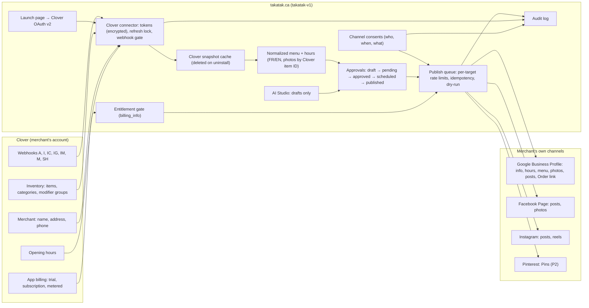

# Architecture: the TAKATAK Clover app (app #3)

Status: **proposal**, 2026-10-23. No code, no schema, no env change in this branch. Names below (tables, routes, env
variables) are proposals for the build PRs.

## 1. Goal

A Clover merchant installs **TAKATAK** from the Clover App Market. TAKATAK reads the merchant's Clover menu, hours and
business info, lets the merchant connect Google Business Profile, Facebook, Instagram (later Pinterest and others), and
publishes to them **at the merchant's direction**: menu and hours kept in sync, posts drafted (with AI) and approved by
the merchant. Billing is done by Clover.

## 2. Where it runs: the decision

| | **A. In takatak-v1 (recommended)** | B. As a third app in the Food Hub backend |
|---|---|---|
| Domain the merchant sees | takatak.ca (Site URL, OAuth, legal pages, support) | foodhub.on2go.ca, then a hop to takatak.ca |
| Clover rule "Alternate Launch Path on the Site URL's base domain" | Natural fit | Needs the Site URL on foodhub.on2go.ca or a proxy |
| Social, listings, AI, approvals | Already in takatak-v1 | Must call takatak-v1 anyway |
| Clover OAuth, entitlement, webhook code | **Ported** from foodhubca (proven) | Reused as is (add a third `CloverAppKey`) |
| Data separation from Food Hub (Clover s.18.2) | Physical: other server, other database | Logical only: same key-value store, other keys |
| Database region | takatak-v1 Supabase `eu-west-1` today (PIA or move, decision D10) | Food Hub Supabase `ca-central-1` for Clover data, but the menu still goes to takatak-v1 |
| Running cost | One system for this app | Two systems for one app |

**Recommendation: A.** Copy the logic of foodhubca `lib/foodhub/pos/clover-oauth.ts`, `clover-entitlement.ts`,
`clover-webhook-gate.ts` and `clover-apps.ts` into takatak-v1 (`src/lib/integrations/clover/`), adapted to Prisma and
`SocialCredential` encryption. Food Hub is not changed. The two apps never share tokens or data; when a merchant has
both, each app reads Clover with its own token. **Clover is the shared source of truth, so the apps do not need to talk
to each other.**

## 3. Big picture

Food Hub (foodhub.on2go.ca) is **not** in this picture on purpose: it is a separate Clover app with its own token, data
and consent.

## 4. Components

### 4.1 Clover connector (`src/lib/integrations/clover/`, ported)

| File (proposed) | Ported from (foodhubca) | Job |
|---|---|---|
| `app.ts` | `lib/foodhub/pos/clover-apps.ts` | App definition from env; off unless the App ID and secret are set |
| `oauth.ts` | `lib/foodhub/pos/clover-oauth.ts` | v2 high-trust flow, signed launch state, single-use refresh with a lock per (app, merchant), "wrong app" check |
| `entitlement.ts` | `lib/foodhub/pos/clover-entitlement.ts` | `billing_info` → allowed / trial / lapsed / inactive; cache 15 min; any `A` event makes it stale |
| `webhook.ts` | `lib/foodhub/pos/clover-webhook-gate.ts` | Verification code, `X-Clover-Auth`, App ID inside the event |
| `read.ts` | new | `/v3/merchants/{mId}`, `/opening_hours`, items, categories, modifier groups (paged, rate-limited) |
| `normalize.ts` | new | Clover → normalized menu and hours (section 5) |
| `uninstall.ts` | new | Export window, then deletion (section 8) |

Routes (proposed):
- `GET /clover/launch` — Site URL and Alternate Launch Path; starts OAuth or resumes the session.
- `GET /api/clover/oauth/callback` — code exchange; creates or finds the workspace; sends to onboarding.
- `POST /api/clover/webhook` — verified webhook.
- `/clover/bienvenue` (onboarding, FR first, `/clover/welcome` EN) — pre-filled from `/v3/merchants`.
- `/dashboard/clover/...` — channels, menu, posts, approvals, consents, subscription status.

Permissions asked from Clover: **Merchant read, Inventory read** only.

### 4.2 What takatak-v1 already has and is reused

| Need | Existing piece (origin/main `4c308b4`) |
|---|---|
| Sign-in, workspaces, roles | Supabase sessions, OTP; `Profile → ClientMembership → Client`; `src/lib/security/data-scope.ts`, `src/lib/security/tenant-access.ts`; `qa:access`, `qa:tenant-isolation` |
| Channel logins and tokens | `src/lib/social/connections/*`, `src/app/api/social/callback/<provider>/*`, `SocialProviderConnection` + `SocialCredential` (AES-GCM, `src/lib/social/security/social-crypto.ts`) |
| Posts and approvals | `SocialPost`, `Approval`, `Campaign`; status machine `src/lib/social/status.ts` |
| Google Business Profile | `src/lib/integrations/google-business/service.ts` (OAuth, reviews, approval-gated replies); `src/lib/social/providers/google-business-profile.ts` (read) |
| AI drafts | AI Studio (`src/lib/ai`, `src/lib/ai-providers`, `src/lib/ai-agents`); TK-069 sends a draft into social approval |
| Brands and locations | `BusinessBrand`, `BusinessLocation` (address, phone, website, time zone, lat/long; **no hours, menu or photos yet**) |
| Audit | `AuditLog` (action, entity, metadata, IP, user agent) |
| Plans | `ProductCatalog`, `ProductPlan`, `ProductEntitlement` |
| Merchant identity | `MasterMerchant`, `SourceMerchant` (`sourceApplication`, `externalMerchantId`) |

What is **missing** and must be built: any publishing code (no channel sends anything today), hours/menu/photo storage,
consents, a publish queue, Clover billing.

### 4.3 New data (proposed Prisma models)

| Model | Key fields | Notes |
|---|---|---|
| `CloverInstallation` | `appId`, `cloverMerchantId`, `clientId`, `status` (active, uninstalled, pending_deletion), encrypted token payload, `accessExpiresAt`, `refreshExpiresAt`, `billingStatus`, `inTrial`, `billingCheckedAt`, `installedAt`, `uninstalledAt`, `deleteAfter` | Unique (`appId`, `cloverMerchantId`) |
| `CloverSnapshot` | `installationId`, `kind` (merchant, hours, inventory), `payload`, `hash`, `fetchedAt` | Cache only; deleted on uninstall |
| `MenuSection`, `MenuItem` | `clientId`, `locationId`, `source` (clover, manual), `cloverItemId`, `nameFr`, `nameEn`, `descriptionFr`, `descriptionEn`, `priceCents`, `currency`, `available`, `photoAssetId`, `dietaryTags` (merchant-entered only) | The normalized menu |
| `LocationHours` | `locationId`, `weekly`, `special`, `source`, `updatedAt` | From Clover opening hours |
| `ChannelConsent` | `clientId`, `locationId`, `channel`, `dataTypes` (menu, prices, hours, info, photos, posts, review_replies), `mode` (sync, approve_each), `textVersion`, `language`, `grantedByProfileId`, `grantedAt`, `revokedAt`, `ipAddress`, `userAgent` | Proof of consent for Clover, Google and Meta |
| `PublishJob` | `clientId`, `channel`, `targetId`, `kind` (menu, hours, info, photo, post), `payloadHash`, `idempotencyKey`, `status` (queued, sending, done, failed, blocked), `attempts`, `externalId`, `error`, `approvalId` | One row per outbound change |

`SourceMerchant` rows with `sourceApplication = "clover"` stay **isolated**: they are not merged into a cross-app
`MasterMerchant` with other sources unless the merchant chooses it outside the Clover flow (Clover s.18.2).

## 5. Data flow: Clover inventory → normalized menu → channels

1. **Install.** Merchant clicks Install / Open in Clover → `/clover/launch` → OAuth v2 → tokens saved in
   `CloverInstallation` (encrypted) → TAKATAK reads merchant, hours and inventory → `CloverSnapshot`.
2. **Account.** Onboarding pre-filled from `/v3/merchants` (name, address, phone, email). The person verifies an email
   or phone (existing OTP) and becomes the workspace owner. One Clover merchant ID = one workspace by default.
3. **Normalize.**
   - Categories → sections; items → items; price in cents, currency CAD; hidden or deleted items left out; modifier
     groups → item options (Google `options`) or a note.
   - Names in French by default; English added by the merchant or drafted by AI and approved.
   - Photos: uploaded or chosen in TAKATAK and attached by Clover item ID (Clover's API does not appear to expose item
     photos).
   - Dietary or allergen tags only from merchant input; never from AI.
4. **Connect channels.** Existing login flows (Google, Meta, Instagram, Pinterest). For each, the merchant picks the
   target (which Google location, which Page) and signs the **channel consent** (data types + mode).
5. **First publish.** A preview shows exactly what goes where ("Menu → Google: 42 items in 6 sections"). The merchant
   approves → `PublishJob` rows → adapters.
6. **Stay in sync.** Webhooks `I`, `IC`, `IG`, `IM` (menu), `M` (info), `SH` (hours) → re-read the changed objects → diff
   against the last published state → for consents in `sync` mode, queue only what changed; otherwise ask for approval.
   An item going out of stock never creates a post.
7. **Posts.** AI Studio drafts (French first, prices only from the normalized menu, Clover ordering link as the button)
   → `SocialPost` draft → `pending_approval` → merchant approves (or edits) → `scheduled` → adapter → `published` or
   `failed`. No auto-publish unless the merchant turned on a recorded, revocable opt-in (P3).

### 5.1 Channel adapters (`src/lib/publishing/<channel>.ts`, proposed)

Common interface: `capabilities(target)`, `publishInfo`, `publishHours`, `publishMenu`, `uploadPhoto`, `publishPost`,
`deletePost`. Every adapter: read before write, idempotency key, per-target limiter, dry-run unless publishing is turned
on, result and error in `PublishJob` and `AuditLog`.

| Channel | Info | Hours | Menu | Photos | Posts | API used | Manual part |
|---|---|---|---|---|---|---|---|
| Google Business Profile | API | API | API (`updateFoodMenus` with `updateMask`) | API | API (ORDER button) | Business Information v1, v4, Place Actions | Manager invite by the merchant; verification by the owner |
| Facebook Page | API (to verify per field) | To verify | Posts/photos | API | API | Pages API | Page role for the merchant |
| Instagram | — | — | Posts only | API (JPEG, public URL) | API | Content Publishing | Professional account linked |
| Pinterest (P2) | — | — | Pins | API | API | Pinterest v5 (Standard access) | Business account |
| Apple, Bing, Yelp (P2+) | Manual | Manual | Manual | Manual | — | none confirmed | TAKATAK prepares text and photos to paste |

Limits enforced inside TAKATAK (below platform limits): Google ≤10 edits/min per location and 300 QPM per project;
Instagram and Facebook a low daily cap per account; no menu push more than once per hour per location (batched).

## 6. Consent and token storage

- **Clover tokens:** `CloverInstallation`, encrypted with the same AES-GCM helper and key versioning as
  `SocialCredential`. Refresh tokens are single-use: one refresh at a time per (app, merchant) — a database row lock or
  advisory lock, ported from Food Hub's per-(app, merchant) lock.
- **Channel tokens:** `SocialCredential` as today (per connection, per workspace).
- **Consents:** `ChannelConsent`, one row per (location, channel), versioned text (FR and EN), revocable from the
  dashboard in one click. Revoking stops jobs at once and offers to remove TAKATAK as Google manager / disconnect Meta.
- **Secrets:** env only (Coolify), never in git. Names (proposed): `CLOVER_TAKATAK_APP_ID`,
  `CLOVER_TAKATAK_APP_SECRET`, `CLOVER_TAKATAK_WEBHOOK_AUTH`, `CLOVER_TAKATAK_ENABLED` (gate, off by default),
  `CLOVER_TAKATAK_METERED_ENABLED` (dry run by default), `TAKATAK_PUBLISHING_LIVE` (dry run by default),
  `CLOVER_TAKATAK_OWN_MERCHANTS` (our restaurants, never billed), `CLOVER_TAKATAK_BLOCKED_MERCHANTS` (hard block: the
  connector refuses any action, for stores the owner never wants touched).

## 7. Billing and entitlements

- Source of truth: Clover `billing_info` for this App ID (status, `isInTrial`). Cached 15 minutes; any `A` event clears
  the cache.
- Mapping: ACTIVE or trial → plan entitlements on (`ProductEntitlement`); LAPSED → read-only (no new publishing) with a
  banner, restored at once when Clover says ACTIVE; INACTIVE / SUPPRESSED / unknown → no publishing; menu sync stops.
- Metered events (if decision D5 keeps any): sent with `POST /v3/apps/{appId}/merchants/{mId}/metereds/{meteredId}`,
  exactly once per event (claim before send), dry run until turned on — same pattern as the Phone AI minutes.
- **Stripe is switched off** for workspaces that came from Clover: no checkout, no AI-credit purchase, no add-on.

## 8. Uninstall and deletion

1. `A` event (uninstall) → `CloverInstallation.status = uninstalled` → all jobs for this workspace stop.
2. Email and dashboard notice (FR first): what stays on the merchant's own Google, Facebook and Instagram accounts (it is
   theirs), how to remove TAKATAK as Google manager, how to export.
3. Export window (proposal: 30 days, to confirm with the lawyer and Clover's "reasonable window").
4. Then delete: tokens, snapshots, normalized menu and hours from Clover, photos uploaded for Clover items, consents'
   content. Keep only what law requires (billing records, a minimal audit trail without content).
5. Channel connections: disconnected and their tokens deleted, unless the merchant chose to keep a separate,
   non-Clover TAKATAK account (a new relationship, new consent, no Clover data).

## 9. Tenancy

- One Clover merchant ID → one `Client` workspace, marked as Clover-sourced.
- Several Clover merchant IDs (several locations or brands) → each installs the app; the owner may link them into one
  workspace only after proving control of each (signed in through each Clover install).
- Every read and write goes through the existing scope helpers; add Clover cases to `qa:tenant-isolation` (one merchant
  cannot see another's menu, consents, jobs or tokens).
- No cross-client analytics on Google or Meta data (Google third-party policy; Meta Platform Terms s.5.b).

## 10. Audit log (actions, proposed)

`clover.install`, `clover.uninstall`, `clover.token.refresh_failed`, `clover.billing.status`, `clover.webhook.received`,
`consent.granted`, `consent.revoked`, `menu.normalized`, `publish.requested`, `publish.approved`, `publish.sent`,
`publish.failed`, `gbp.manager.added`, `gbp.menu.updated`, `post.published`, `data.export`, `data.deleted`.
Each entry: workspace, person, IP and user agent (Clover Terms s.3.7 asks for app users' IPs), no message bodies or
tokens.

## 11. Security and privacy defaults

- Least privilege everywhere: two Clover permissions; only the Google and Meta scopes the feature needs.
- Privacy by default (P-39.1 s.9.1): no auto-publish, no review auto-reply, no sharing beyond chosen channels.
- AI provider receives business data only (menu, hours, brand voice, the merchant's prompt), never customer or staff
  personal information.
- Google content stored ≤30 days (purge job), no aggregation across clients.
- Meta data deletion callback; vulnerability contact; incident runbook.
- Data region: see decision D10 (keep `eu-west-1` with a PIA, or put Clover-sourced data in `ca-central-1`).

## 12. Not in scope of this app

- Delivery marketplaces (Uber Eats, DoorDash, Skip…): TAKATAK Food Hub's job, its own Clover app.
- A public TAKATAK directory, QMAPS or a marketplace of businesses fed by Clover data.
- Installing code on Clover devices; any "plugin" system.
- Payments or ordering outside Clover.
